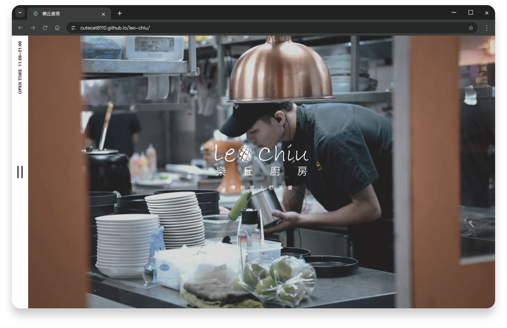

# 樂丘廚房｜餐廳形象網站


以 HTML、SCSS 與 JavaScript 製作餐點輪播、章節導覽、菜單及 FAQ 互動。

**[Demo](https://cutecat8110.github.io/leo-chiu/)**



<details>
<summary>使用說明</summary>

SEND、訂位、READ MORE、DETAIL 為展示元件，不會寄出資料或建立訂位。字型、圖示及部分套件由外部 CDN 載入。

</details>

<details>
<summary>開發、測試與部署</summary>

這是純靜態作品，預覽不需要安裝前端依賴或建立後端。在專案目錄執行：

```sh
python3 -m http.server 8765 --bind 127.0.0.1
```

瀏覽 `http://127.0.0.1:8765/`。請使用 HTTP 伺服器預覽，避免以 `file://` 開啟時 SVG 載入受到限制。

- 開發與發布統一使用 `main`。GitHub Pages 設定使用 `Deploy from a branch`、`main`、`/ (root)`。
- [逐項修正、重現步驟、驗證結果與已知限制](QA_CHANGELOG.md)
- [第一輪測試結果](docs/qa/results.json)／[第二輪測試結果](docs/qa/round2-results.json)
- SEND、訂位、READ MORE、DETAIL 等原有展示元件未新增功能；此版本不會送出聯絡資料或建立訂位。

原本的主樣式保留。補充樣式位於 `scss/qa.scss`，瀏覽器載入其編譯產物 `css/qa.css`。修改該 SCSS 後，使用 Node.js/npm 編譯並一併提交兩個檔案：

```sh
npx --yes sass@1.93.2 --no-source-map scss/qa.scss css/qa.css
node --check js/index.js
git diff --check
```

Swiper 的 JavaScript 與 CSS 固定為 `14.3.0`；字型、圖示、jQuery 與 Swiper 仍由外部 CDN 提供，預覽需要網路連線。

### 素材維護

原始圖片與設計保留，網站引用預先產生的 WebP。更新原圖後，以 Node 22 執行 `npm ci`、`npm run images:optimize`；一併提交 WebP 與 `qa/image-sizes.json`，一般發布不會即時轉圖。圖片來源與輸出清單在 `scripts/image-sources.json`。僅本機預覽依然只需 Python HTTP server；不需要執行 npm。

</details>

<details>
<summary>技術與套件</summary>

[HTML](https://developer.mozilla.org/zh-TW/docs/Web/HTML) · [CSS](https://developer.mozilla.org/zh-TW/docs/Web/CSS) · [JavaScript](https://developer.mozilla.org/zh-TW/docs/Web/JavaScript) · [jQuery](https://jquery.com/) · [Swiper](https://swiperjs.com/)

</details>

[QA 紀錄](QA_CHANGELOG.md) · [介面設計規範](DESIGN_GUIDELINES.md)
